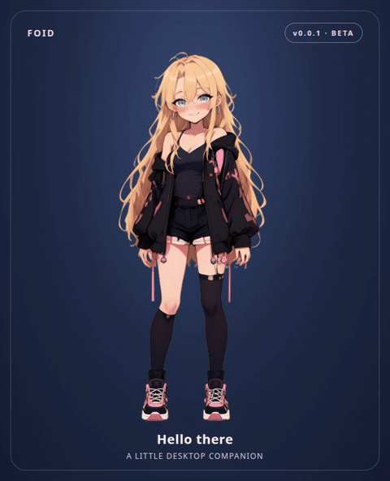

# Foid v0.0.1 beta

**[Meet Foid — live demo](https://cc-david-cc.github.io/foid/)**



Foid is a steerable, browser-rendered Rive companion for websites and desktop webviews. This beta includes the website module, an interactive example, and a local command-line host. The animation is a rough draft: turns use staged views, walking can slide, and talking is simulated rather than lip-synced.

This folder is a self-contained **rough-draft** Foid presentation. `index.mjs` is the website entry point; keep the accompanying `assets/` folder alongside it. The assets include the compiled Rive character and the Rive WebAssembly runtime. The module, `.riv`, and `.wasm` must be served over HTTP(S) from the same origin as the page. Do not open the HTML using `file://` or load the assets from a different origin. A WebGL2-capable browser or webview is required.

From this folder, run `python3 -m http.server 5181 --bind 127.0.0.1`, then open `http://127.0.0.1:5181/example.html`. The example is a local simulation; its controls do not perform tasks.

For a website, copy this entire folder into e.g. `/foid/` on your server, then:

```html
<div id="foid" style="width: 320px; height: 520px"></div>
<script type="module">
  import { mount } from '/foid/index.mjs';

  // mount returns synchronously; loading Rive happens asynchronously.
  const foid = mount(document.querySelector('#foid'));
  await foid.ready;
  foid.setExpression('happy');
  foid.setLook(0.4, -0.1);       // x and y are -1 to 1
  foid.setHeadTilt(0.15);         // -1 to 1
  foid.setBlush(0.7);             // 0 to 1
  foid.gesture('greet');

  // Refresh only while your app has fresh state to report.
  // foid.update();
  // When removing the avatar: foid.dispose();
</script>
```

A host element must have a nonzero width and height. The canvas is transparent; the example supplies a background separately. Each `mount` creates an independent instance. `mount(host, {worldId, sessionId, leaseMs, assetUrl})` accepts optional identifiers, lease of 1–30000 ms (default 30000), and a same-origin override for the `.riv` file. `ready` rejects if loading fails; call `dispose()` when removing the avatar. Under a strict Content Security Policy, the embed requires permission for its inline scoped style and WebAssembly.

## Hosting on GitHub Pages

This repository includes `index.html` and the required same-origin assets. In repository **Settings → Pages**, choose **Deploy from a branch**, select `main` and `/ (root)`, then save. After GitHub finishes the deployment, the example is available at `https://cc-david-cc.github.io/foid/`. The local CLI runs on your own machine and is not hosted by Pages.

## Steering

- `blink()` requests a natural blink; reduced-motion or disconnected state suppresses it.
- `setExpression(name)`: `neutral`, `playful`, `teasing`, `happy`, `thinking`, `surprised`, `sleepy`, `pouty`. Re-select `teasing` or `happy` to replay the brief eye animation; her eyes reopen automatically.
- `setLook(x, y)`, `setHeadTilt(value)`, `setEnergy(value)`, `setMotionAmount(value)`, and `setBlush(value)` steer continuous properties. Look and head tilt use -1 to 1; energy, motion amount and blush use 0 to 1.
- `setFacing(name)`: `front`, `right`, `left`, `back`.
- `setMovement(name)`: `still`, `walk`, `run`, `fidget`, `dance`, `doze`, `sleep`, `sit`, `sit_type`. The walk/run animation plays in place unless the host also moves the element. The sit pose does not draw a seat; the host supplies a surface if desired.
- `gesture(name)`: task-free gestures are `greet`, `cheer`, `drink`, `play_game`. The avatar must be live; cues received immediately on reconnection do not replay.
- `setSpeech({speaking: true, viseme: 'auto'})` starts simulated mouth movement. Set `speaking: false` to stop. For a known mouth shape use `closed`, `open`, `wide`, `round`, or `teeth`; alternatively pass a supported ARPABET phoneme, e.g. `{speaking: true, phoneme: 'AH1'}`. This module does not play audio, synthesize a voice, analyze audio, or perform lip synchronization.
- `setReducedMotion(true)` suppresses vigorous motion; the operating system's reduced-motion preference is also respected. `presentationState()` reports current status and movement codes.
- `setStatus('idle' | 'listening' | 'working' | 'waiting' | 'error' | 'disconnected')` is a convenience for simple hosts. For actual agents prefer explicit task snapshots below.

## Agent state and task gestures

Each accepted update has a limited lease. When it expires Foid becomes disconnected, so a stale backend does not appear active. `update()` renews the last state; send it only when your application has genuinely received fresh state. The demo's timer is appropriate because the demo itself is the state source; do not use an unconditional timer to impersonate a live agent.

```js
foid.update({
  tasks: [{ id: 'draft-42', phase: 'running', label: 'Writing a draft' }],
  attention: false,
  condition: 'ok',
  summary: 'Writing a draft',
  look: { x: 0.2, y: 0 },
  headTilt: 0,
  energy: 0.6,
  motionAmount: 0.5
});
foid.gesture('type', { taskId: 'draft-42' });
// Later, report the real task outcome before a completion gesture:
foid.update({ tasks: [{ id: 'draft-42', phase: 'succeeded', label: 'Draft ready' }], summary: 'Draft ready' });
foid.gesture('explain', { taskId: 'draft-42' });
```

Task-bound `read`, `type`, `take_notes` require a matching `running` task; `explain` and `acknowledge` require `succeeded`; `cancel` requires `cancelled`. `update` accepts any subset of `tasks`, `attention`, `condition`, `summary`, `look`, `headTilt`, `energy`, and `motionAmount`. Task objects have exactly `id`, `phase`, and `label`; supported phases are `queued`, `running`, `waiting`, `succeeded`, `failed`, `cancelled`. `condition` is `unknown`, `ok`, `degraded`, or `error`. Identifiers use letters, digits, `_`, `.`, `:`, or `-`, up to 96 characters. A failed task drives error presentation. Updates and gestures are presentation events, not authorization or job execution.

## Local command-line host

Requires Node.js 22 or newer. From this folder, start the local server:

```sh
node cli.mjs serve
```

Open the printed URL (`http://127.0.0.1:5182/` by default), keep it open, and use a second terminal:

```sh
node cli.mjs preset listening
node cli.mjs expression happy
node cli.mjs gesture greet
node cli.mjs task draft-42 running "Writing a draft"
node cli.mjs gesture type draft-42
node cli.mjs speech auto
node cli.mjs speech stop
node cli.mjs facing right
node cli.mjs movement walk
node cli.mjs travel 250
node cli.mjs status idle
```

Run `node cli.mjs help` for all commands; add `--port 5182` to use a chosen port. The CLI server listens only on `127.0.0.1` and sends commands to currently open CLI viewer pages. A successful send means the viewer received the command, not that an external task was performed; the viewer displays presentation errors. Commands fail if no viewer is connected. The server sends liveness heartbeats for this manual local host; a disconnected viewer resets when its connection is lost. Stop the server with Ctrl+C.

## Desktop movement

For a browser-like desktop shell, mount inside an absolutely positioned host and use the exported `createDesktopWalker` to translate that host while Rive plays the gait. A normal web page cannot place a window outside the browser; an actual desktop companion needs a native shell/webview and its own window placement. The helper does not create native windows, handle click-through, or guarantee perfect foot contact.

```js
import { mount, createDesktopWalker } from '/foid/index.mjs';
const avatar = mount(document.querySelector('#avatar-host'));
await avatar.ready;
const walker = createDesktopWalker({
  character: avatar,
  container: document.querySelector('#desktop-area'),
  element: document.querySelector('#avatar-host'),
  speed: 120,
  turnDelayMs: 300,
  reverseTurnDelayMs: 600
});
await walker.walkTo(400); // pixels within the container
// walker.cancel(); walker.dispose(); avatar.dispose();
```

The container must be positioned, and the host must have `position: absolute`, a width and height, and suitable vertical positioning. The result resolves with a reason such as `arrived` or `interrupted`; movement stops when state expires, disconnects, or reduced motion is enabled.

## Rebuilding

From `source/runtime/`, install pinned dependencies with `npm ci` (Node.js 22+), then run `npm run build`. The output is `source/runtime/dist-foid-embed/`. The editable Rive source and its artwork are in `source/rive/`; the website module source is `source/runtime/foid-embed/index.mjs`. The build uses the included compiled binary, and copies the example, CLI, GIF and README into its output.

## Third-party runtime

The bundled `@rive-app/webgl2` runtime is MIT-licensed by Rive. See [THIRD_PARTY_RIVE_LICENSE.txt](THIRD_PARTY_RIVE_LICENSE.txt).
